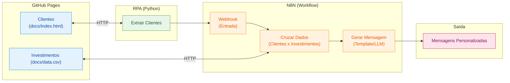

# Assistente de Investimentos com RPA e IA Generativa

## Descrição

Fluxo de automação inteligente combinando técnicas de RPA (Robotic Process Automation) com workflows de IA no N8N.

Um assistente de investimentos automatizado. O fluxo começa com a extração de dados de clientes em uma página web usando Python, passa pela orquestração de um workflow no N8N e termina com a geração de mensagens personalizadas para cada perfil de investidor.

## Objetivo do Projeto

Desenvolver um pipeline de automação que:

1. **Coleta dados de clientes** de uma página web simulada usando Python
2. **Processa as informações** através de um workflow no N8N
3. **Cruza perfis de investidor** com uma base de opções de investimento
4. **Gera mensagens personalizadas** para cada cliente

## Arquitetura do Projeto



## Tecnologias e Ferramentas

O projeto utiliza ferramentas gratuitas e acessíveis, organizadas conforme cada etapa do fluxo:

| Etapa | Ferramenta | Função |
|-------|-----------|--------|
| Hospedagem | GitHub Pages | Servir a página de clientes e o CSV de investimentos |
| Extração (RPA) | Python + BeautifulSoup | Coletar dados dos clientes via web scraping |
| Orquestração | N8N | Processar dados, cruzar perfis e gerar mensagens |
| Geração com IA | Agente de IA no N8N | Criar mensagens personalizadas com LLM (desafio extra) |

## Estrutura do Repositório

```
📁 dio-lab-assistente-investimentos-rpa-n8n/
├── 📄 README.md
├── 📁 src/
│   └── 📄 extrair_clientes.ipynb   
├── 📁 n8n/
│   └── 📄 workflow.json           
└── 📁 docs/
    ├── 📄 index.html              
    └── 📄 data.csv                 
```
---
## Como o fluxo funciona
- Receber Clientes (Webhook POST /clientes): recebe {"clientes": [...]}, o mesmo formato que o notebook já monta.
- Carregar investimentos: baixa o data.csv do GitHub Pages, lê o arquivo e junta os 9 produtos numa lista.
- Cruzar perfis: separa cada cliente, converte o saldo ("R$ 12.500,00" vira 12500) e mantém só os produtos do mesmo perfil cujo valor mínimo cabe no saldo. Também monta a mensagem fixa de cada perfil (Conservador = renda fixa e segurança; Moderado = equilíbrio; Arrojado = ações).
- Gerar recomendações: um Agente de IA com Gemini (gemini-3.5-flash) escreve uma mensagem personalizada para cada cliente. Ele só pode recomendar os produtos compatíveis e não pode prometer retorno.
- Devolver resultado: responde ao script Python com a lista mensagens. Cada item traz nome, email, saldo, perfil, opcoes, mensagem_estatica e mensagem_ia.
